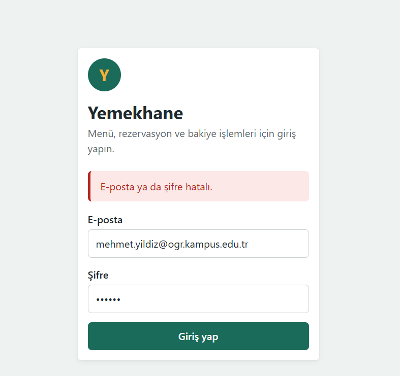
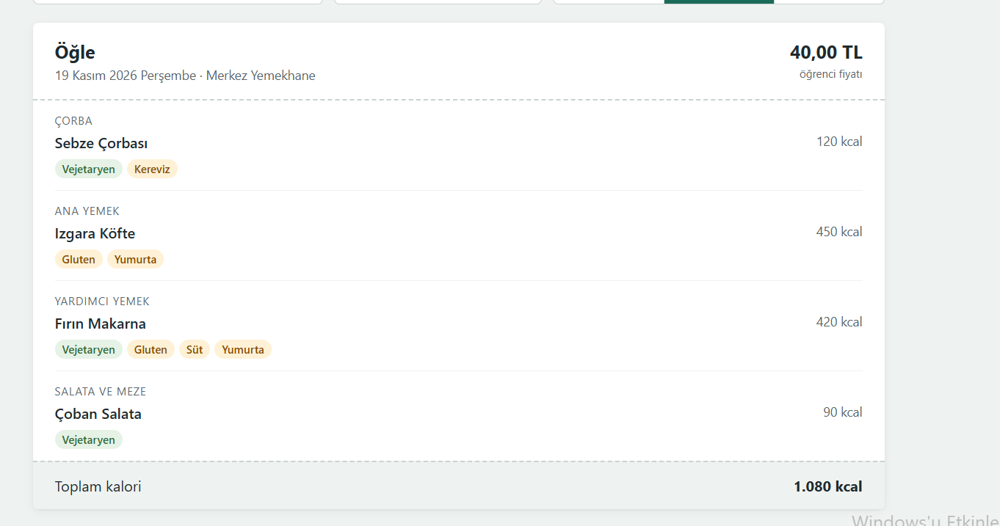
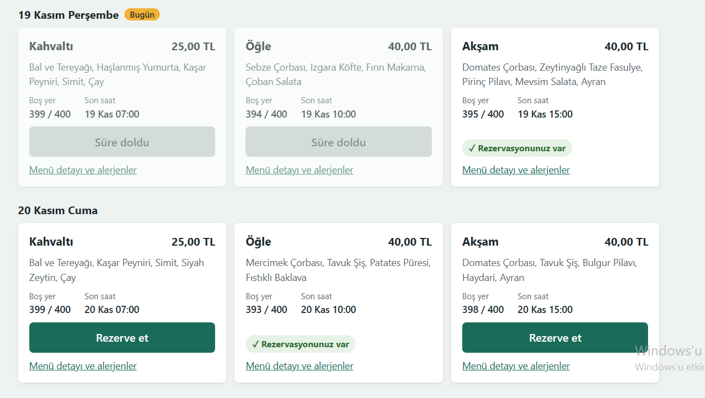
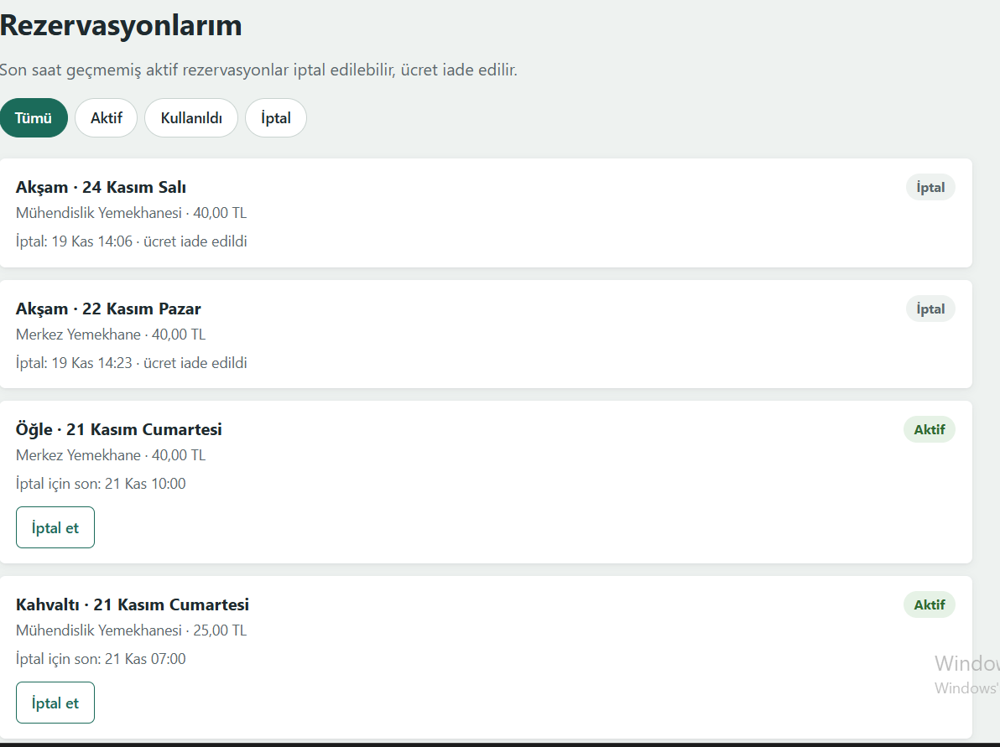
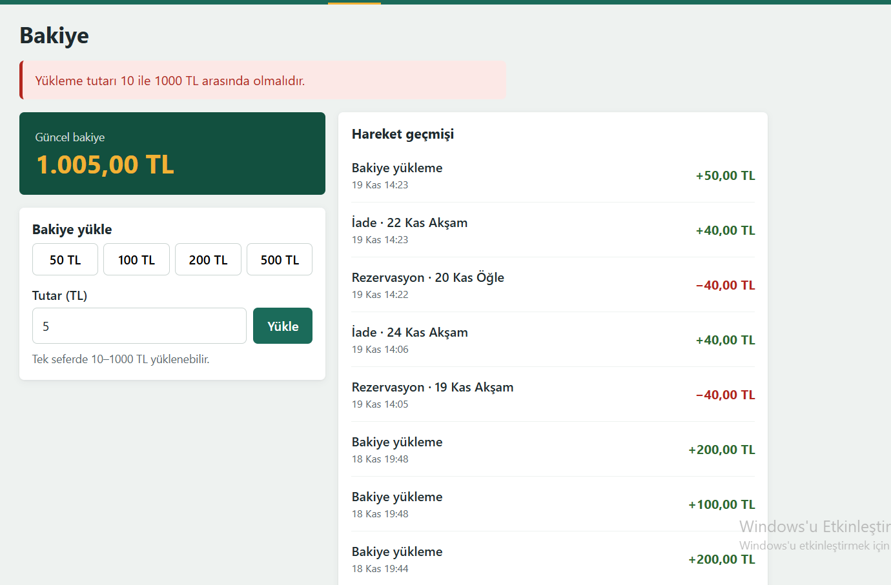
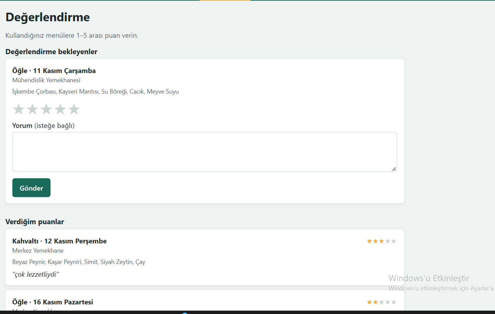
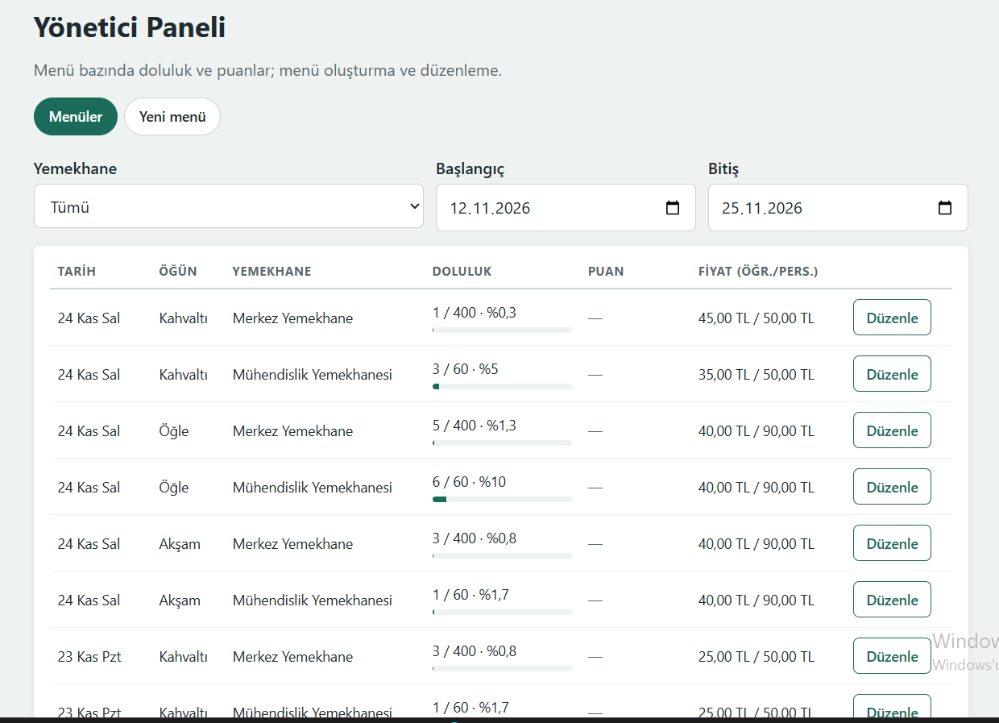
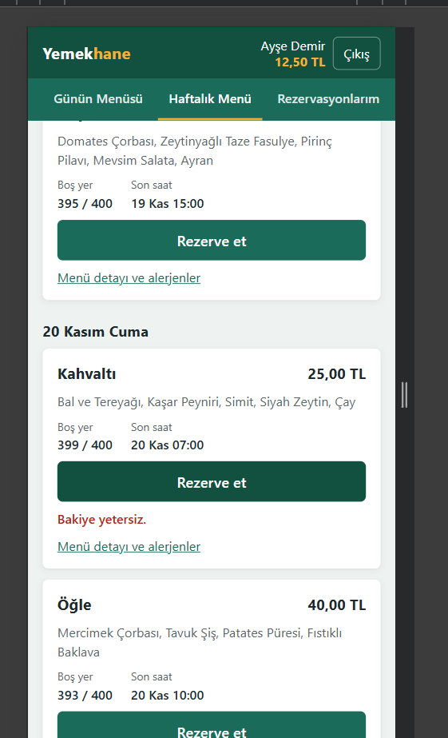

# Yemekhane Otomasyonu · Dönem Ödevi Raporu

**Ders:** Web Teknolojileri
**Öğrenci:** Hasari Güneş · ÖĞRENCİ NO
**Depo:** https://github.com/guneshasari03-cpu/yemekhane

**Seçilen mimari: Web API + arayüz.**
Uygulama Node.js 22 + Express ile yazılmıştır ve yalnızca JSON döner. HTML5 + CSS3 arayüz
`frontend/` klasöründe durur, Apache tarafından sunulur ve veriyi JavaScript `fetch` ile alır.
Apache `/api/` isteklerini `uygulama` servisine (port 8000) iletir.

---

## Aşama 1 · Altyapı

Ortam: Windows 11, Docker Desktop 4.99.0 (WSL 2), komutlar Git Bash'te çalıştırıldı.

Başlangıç paketi depo kökünde `docker compose up -d` ile ek adım olmadan ayağa kalktı.
Doğrulama komutlarının tamamı `rapor/asama1-dogrulama.sh` betiğiyle sırayla çalıştırıldı;
betik her komutu ve çıktısını `rapor/asama1-cikti.txt` dosyasına yazar. Aşağıda her madde için
komut ve çıktı verilmiştir (parola uyarısı satırları çıkarılmıştır).

### 1.1 Tüm servisler healthy, replica-setup başarıyla çıkmış

```
$ docker compose ps -a
NAME                        IMAGE                SERVICE         STATUS
yemekhane-frontend-1        yemekhane-frontend   frontend        Up 13 minutes (healthy)
yemekhane-mysql-primary-1   mysql:8.4            mysql-primary   Up 13 minutes (healthy)
yemekhane-mysql-replica-1   mysql:8.4            mysql-replica   Up 4 minutes (healthy)
yemekhane-redis-1           redis:7.4-alpine     redis           Up 13 minutes (healthy)
yemekhane-replica-setup-1   mysql:8.4            replica-setup   Exited (0) 12 minutes ago
```


Dört uzun ömürlü servis `healthy`, tek seferlik `replica-setup` servisi `Exited (0)` ile
başarıyla çıkmıştır. Günlüğü kurulum adımlarını ve ikinci `docker compose up -d` çağrısında
kurulumun tekrarlanmadığını gösterir:

```
$ docker compose logs replica-setup
[replica-setup] Kaynakta replikasyon kullanıcısı oluşturuluyor.
[replica-setup] Kaynağın anlık kopyası alınıyor.
[replica-setup] Kopya replikaya yükleniyor.
[replica-setup] Replikasyon başlatılıyor.
[replica-setup] Replikasyon çalışıyor (IO=Yes, SQL=Yes). Replika salt okunur.
[replica-setup] Replika zaten yapılandırılmış, işlem yapılmadı.
```

Replikasyonun durumu: IO ve SQL iş parçacıkları çalışıyor, gecikme 0 saniye, hata yok.

```
$ docker compose exec -T mysql-replica mysql --default-character-set=utf8mb4 -uroot -pyemekhane_kok \
    -e "SHOW REPLICA STATUS\G" | grep -E 'Source_Host|Replica_IO_Running|Replica_SQL_Running:|Seconds_Behind_Source|Last_IO_Error:|Last_SQL_Error:'
                  Source_Host: mysql-primary
           Replica_IO_Running: Yes
          Replica_SQL_Running: Yes
        Seconds_Behind_Source: 0
                Last_IO_Error:
               Last_SQL_Error:
```

Apache de `http://localhost:8080` adresinde başlangıç sayfasını sunmaktadır (uygulama servisi
henüz eklenmediği için sayfa "Uygulama servisine ulaşılamıyor" uyarısını gösterir):


### 1.2 Kaynakta yapılan bakiye yüklemesi replikada görünüyor

Kaynakta 7 numaralı kullanıcının bakiyesi 655,00 TL'dir. `sp_bakiye_yukle` yordamı **kaynakta**
çağrılarak 100 TL yüklenir:

```
$ docker compose exec -T mysql-primary mysql --default-character-set=utf8mb4 -t -uyemekhane_app -pUyg_2026 yemekhane \
    -e "SELECT id, ad, soyad, bakiye FROM kullanicilar WHERE id = 7"
+----+--------+----------+--------+
| id | ad     | soyad    | bakiye |
+----+--------+----------+--------+
|  7 | Mehmet | Yıldız   | 655.00 |
+----+--------+----------+--------+

$ docker compose exec -T mysql-primary mysql --default-character-set=utf8mb4 -t -uyemekhane_app -pUyg_2026 yemekhane \
    -e "CALL sp_bakiye_yukle(7, 100)"
+------------+--------+
| hareket_id | bakiye |
+------------+--------+
|        457 | 755.00 |
+------------+--------+
```

Aynı sorgu **replikada** çalıştırıldığında yeni bakiye ve yeni bakiye hareketi görünür:

```
$ docker compose exec -T mysql-replica mysql --default-character-set=utf8mb4 -t -uyemekhane_app -pUyg_2026 yemekhane \
    -e "SELECT id, ad, soyad, bakiye FROM kullanicilar WHERE id = 7"
+----+--------+----------+--------+
| id | ad     | soyad    | bakiye |
+----+--------+----------+--------+
|  7 | Mehmet | Yıldız   | 755.00 |
+----+--------+----------+--------+

$ docker compose exec -T mysql-replica mysql --default-character-set=utf8mb4 -t -uyemekhane_app -pUyg_2026 yemekhane \
    -e "SELECT id, tur, tutar, aciklama, olusturma FROM bakiye_hareketleri WHERE kullanici_id = 7 ORDER BY id DESC LIMIT 1"
+-----+---------+--------+-----------------+---------------------+
| id  | tur     | tutar  | aciklama        | olusturma           |
+-----+---------+--------+-----------------+---------------------+
| 457 | yukleme | 100.00 | Bakiye yükleme  | 2026-11-18 19:48:47 |
+-----+---------+--------+-----------------+---------------------+
```

Hem `kullanicilar` tablosundaki güncelleme hem de `bakiye_hareketleri` tablosuna eklenen satır
(aynı `hareket_id` = 457) replikaya geçmiştir; yordamın tek transaction'ı replikada bütün
olarak uygulanmıştır.

### 1.3 Replikaya yazma denemesi read-only hatasıyla reddediliyor

`replica-setup` replikayı `SET PERSIST` ile kalıcı olarak salt okunur yapmıştır:

```
$ docker compose exec -T mysql-replica mysql --default-character-set=utf8mb4 -t -uyemekhane_app -pUyg_2026 yemekhane \
    -e "SELECT @@read_only, @@super_read_only"
+-------------+-------------------+
| @@read_only | @@super_read_only |
+-------------+-------------------+
|           1 |                 1 |
+-------------+-------------------+
```

Uygulama kullanıcısının replikada yazma yetkisi olduğu hâlde hem yordam çağrısı hem de doğrudan
`UPDATE` reddedilir. Hata yetki hatası değil, read-only hatasıdır (ERROR 1290):

```
$ docker compose exec -T mysql-replica mysql --default-character-set=utf8mb4 -t -uyemekhane_app -pUyg_2026 yemekhane \
    -e "CALL sp_bakiye_yukle(7, 50)"
ERROR 1290 (HY000) at line 1: The MySQL server is running with the --super-read-only option so it cannot execute this statement

$ docker compose exec -T mysql-replica mysql --default-character-set=utf8mb4 -t -uyemekhane_app -pUyg_2026 yemekhane \
    -e "UPDATE kullanicilar SET bakiye = 0 WHERE id = 7"
ERROR 1290 (HY000) at line 1: The MySQL server is running with the --read-only option so it cannot execute this statement
```

Bu yüzden uygulamada yazma işlemleri (yordam çağrıları dahil) yalnızca `mysql-primary`
bağlantısından yapılmalıdır.

### 1.4 Replika durdurulup başlatıldığında aradaki değişiklikleri yakalıyor

Replika durdurulur, durduğu doğrulanır:

```
$ docker compose stop mysql-replica
 Container yemekhane-mysql-replica-1 Stopped

$ docker compose ps -a mysql-replica
NAME                        IMAGE       SERVICE         STATUS
yemekhane-mysql-replica-1   mysql:8.4   mysql-replica   Exited (0) Less than a second ago
```

Replika kapalıyken kaynakta 200 TL yüklenir; kaynaktaki bakiye 955,00 TL olur:

```
$ docker compose exec -T mysql-primary mysql --default-character-set=utf8mb4 -t -uyemekhane_app -pUyg_2026 yemekhane \
    -e "CALL sp_bakiye_yukle(7, 200)"
+------------+--------+
| hareket_id | bakiye |
+------------+--------+
|        458 | 955.00 |
+------------+--------+
```

Replika yeniden başlatılır ve `healthy` olduktan sonra aynı bakiye replikada görünür:

```
$ docker compose start mysql-replica
 Container yemekhane-mysql-replica-1 Started

$ docker compose ps -a mysql-replica
NAME                        IMAGE       SERVICE         STATUS
yemekhane-mysql-replica-1   mysql:8.4   mysql-replica   Up 8 seconds (healthy)

$ docker compose exec -T mysql-replica mysql --default-character-set=utf8mb4 -t -uyemekhane_app -pUyg_2026 yemekhane \
    -e "SELECT id, bakiye FROM kullanicilar WHERE id = 7"
+----+--------+
| id | bakiye |
+----+--------+
|  7 | 955.00 |
+----+--------+

$ docker compose exec -T mysql-replica mysql --default-character-set=utf8mb4 -uroot -pyemekhane_kok \
    -e "SHOW REPLICA STATUS\G" | grep -E 'Replica_IO_Running|Replica_SQL_Running:|Seconds_Behind_Source|Retrieved_Gtid_Set|Executed_Gtid_Set'
           Replica_IO_Running: Yes
          Replica_SQL_Running: Yes
        Seconds_Behind_Source: 0
           Retrieved_Gtid_Set: f7bef3df-e36d-11f1-aaee-d611d0c6d975:43-46
            Executed_Gtid_Set: f7bef3df-e36d-11f1-aaee-d611d0c6d975:1-46
```

Replikasyon GTID otomatik konumlandırma (`SOURCE_AUTO_POSITION = 1`) ile kurulduğu için replika
yeniden bağlandığında kaynağa "elimde 1–45 arası işlemler var" bilgisini gönderir, kaynak da
eksik olan 46 numaralı işlemi (kapalıyken yapılan 200 TL yükleme) yollar. `Executed_Gtid_Set`
değerinin `1-46` olması replikanın kaynaktaki tüm işlemleri uyguladığını gösterir.

### 1.5 Ek: bakiye tutarlılığı

Şemadaki "bakiye her zaman hareketlerin toplamına eşittir" kuralı replikada da geçerlidir:

```
$ docker compose exec -T mysql-replica mysql --default-character-set=utf8mb4 -t -uyemekhane_app -pUyg_2026 yemekhane \
    -e "SELECT k.id, k.bakiye, SUM(h.tutar) AS hareket_toplami FROM kullanicilar k JOIN bakiye_hareketleri h ON h.kullanici_id = k.id WHERE k.id = 7 GROUP BY k.id, k.bakiye"
+----+--------+-----------------+
| id | bakiye | hareket_toplami |
+----+--------+-----------------+
|  7 | 955.00 |          955.00 |
+----+--------+-----------------+

$ docker compose exec -T redis redis-cli ping
PONG
```

---

## Aşama 2 · Uygulama

### 2.1 Mimari ve katmanlar

Seçilen yol **Web API + arayüz**dür. `uygulama` servisi (Node.js 22 + Express 5) yalnızca JSON
döner; `frontend/` klasöründeki HTML5 + CSS3 sayfalar Apache'den sunulur ve veriyi `fetch` ile
alır (React vb. çerçeve kullanılmamıştır). Apache `/api/` ile başlayan istekleri
`http://uygulama:8000`'e iletir. Uygulama `docker-compose.yml`'ye `uygulama` servisi olarak
eklenmiş, `wget` ile `/api/` adresini yoklayan bir healthcheck verilmiştir.

```
uygulama/src/
├── sunucu.js              Express kurulumu, istek günlüğü, hata yakalayıcı
├── rotalar.js             Tüm yollar: yol -> middleware -> denetleyici
├── ara/                   Middleware: kimlik.js (oturum, yönetici), hataYakala.js
├── denetleyiciler/        HTTP katmanı: girdiyi okur/doğrular, yanıtı yazar. SQL YOK.
├── servisler/             İş kuralları (fiyat seçimi, "yalnızca kullanılan menü puanlanır" vb.)
├── veri/                  Veri katmanı: SQL yalnızca burada. baglanti.js iki havuz tutar.
└── oturum/                Oturum deposu (Aşama 2: bellek, Aşama 3: Redis)

frontend/
├── index.html … yonetim.html   7 ekran
├── js/api.js              Tüm fetch çağrıları; sunucunun {hata} mesajını Error'a çevirir
├── js/ortak.js            Üst çubuk, gezinme, biçimlendirme (iş kuralı yok, yalnız gösterim)
└── css/uygulama.css       Mobil önce yazılmış stiller
```

Kurallar: **denetleyicilerde SQL yoktur** (yalnızca `veri/` klasöründe), **arayüz kodunda iş
kuralı yoktur**. Fiyatın role göre seçimi, son saatin geçip geçmediği, iptal edilebilirlik ve
değerlendirilebilirlik kararları API'den hazır gelir; arayüz yalnızca bunları gösterir. Bakiye
yükleme sınırı (10–1000 TL) gibi kurallar stored procedure'dedir ve arayüzde tekrar edilmez.

### 2.2 Bir isteğin yolu: rezervasyon

`POST /api/rezervasyonlar` isteğinin uygulama içindeki yolu:

**1. Rota** (`rotalar.js`): önce oturum kontrolü, sonra denetleyici.

```js
r.post('/rezervasyonlar', girisGerekli, rezervasyon.olustur);
```

**2. Middleware** (`ara/kimlik.js`): HttpOnly çerezdeki token ile oturumu bulur, `req.kullanici`yı doldurur; yoksa 401.

**3. Denetleyici** (`denetleyiciler/rezervasyonDenetleyici.js`): girdiyi doğrular, veri katmanını çağırır, yanıtı yazar.

```js
async function olustur(req, res) {
  const menuId = dogrula.pozitifTamsayi(req.body?.menu_id, 'Menü');
  const sonuc = await rezervasyonDeposu.rezervasyonYap(req.kullanici.id, menuId);
  res.status(201).json(sonuc);   // { rezervasyon_id, ucret, bakiye }
}
```

**4. Veri katmanı** (`veri/rezervasyonDeposu.js` → `veri/baglanti.js`): yordam her zaman **kaynakta** çağrılır.

```js
async function rezervasyonYap(kullaniciId, menuId) {
  return db.yordam('sp_rezervasyon_yap', [kullaniciId, menuId]);
}

// baglanti.js
async function yordam(ad, parametreler = []) {
  const sql = `CALL ${ad}(${parametreler.map(() => '?').join(', ')})`;
  const [sonuclar] = await yazmaHavuzu.query(sql, parametreler);   // mysql-primary
  return sonuclar[0][0];
}
```

**5. Yanıt**: Başarıda `201` ve yordamın döndürdüğü `{ rezervasyon_id, ucret, bakiye }`. Yordam
`SIGNAL SQLSTATE '45000'` ile hata verirse (ör. "Bakiye yetersiz.") hata `ara/hataYakala.js`'e
düşer ve **mesaj değiştirilmeden** `400 {"hata":"Bakiye yetersiz."}` olarak döner:

```js
if (hata.errno === 1644 || hata.sqlState === '45000') {
  return res.status(400).json({ hata: hata.sqlMessage || hata.message });
}
```

Arayüzde `js/api.js` bu mesajı `Error` yapar, `js/hafta.js` kartın altında kırmızı olarak gösterir.
CHECK ihlali gibi beklenmeyen veritabanı hataları ise kullanıcıya gösterilmez; günlüğe yazılır ve
genel bir "Beklenmeyen bir hata oluştu" mesajı döner.

### 2.3 Stored procedure kullanımı

| İşlem | Uç nokta | Yordam |
|---|---|---|
| Rezervasyon | `POST /api/rezervasyonlar` | `sp_rezervasyon_yap` |
| İptal | `DELETE /api/rezervasyonlar/:id` | `sp_rezervasyon_iptal` |
| Bakiye yükleme | `POST /api/bakiye` | `sp_bakiye_yukle` |

Yordamlar kendi transaction'larını açtığı için uygulama bunları `BEGIN/COMMIT` ile sarmaz.
Yordamı olmayan çok adımlı yazmalar (yönetici panelinde menü oluşturma/düzenleme:
`menuler` + `menu_yemekleri`) `baglanti.js`'teki `islem()` ile tek transaction içinde yapılır;
hata olursa `ROLLBACK` edilir.

### 2.4 Okuma / yazma ayrımı

`veri/baglanti.js` iki bağlantı havuzu tutar: `yazmaHavuzu` → `mysql-primary`,
`okumaHavuzu` → `mysql-replica`. Veri katmanı dört fonksiyondan birini kullanır ve her sorgu
günlüğe hangi sunucuya gittiğiyle yazılır:

| Fonksiyon | Sunucu | Kullanım |
|---|---|---|
| `oku()` | replika | Menüler, haftalık liste, rezervasyon listesi, hareket geçmişi, yönetici raporu |
| `birincildenOku()` | kaynak | Güncel bakiye, yazmadan hemen önce/sonra okunan veri |
| `yaz()`, `islem()` | kaynak | INSERT / UPDATE / DELETE |
| `yordam()` | kaynak | Stored procedure çağrıları |

Uygulama günlüğünden (`rapor/asama2-gunluk.txt`) haftalık menüden rezervasyon, iptal ve
bakiye yükleme akışı:

```
[sql:okuma/replika] SELECT d.menu_id, d.tarih, d.ogun_id, d.ogun, d.kapasite, d.bos_yer, …
GET /api/menuler/hafta?yemekhane=1&baslangic=2026-11-19 -> 200 (3 ms)
[sql:yazma/kaynak] CALL sp_rezervasyon_yap(?, ?)
POST /api/rezervasyonlar -> 201 (7 ms)
[sql:okuma/kaynak] SELECT bakiye FROM kullanicilar WHERE id = ?
GET /api/ben -> 200 (2 ms)
[sql:okuma/replika] SELECT r.id, r.menu_id, r.durum, r.ucret, r.olusturma, …
GET /api/rezervasyonlar -> 200 (3 ms)
[sql:yazma/kaynak] CALL sp_rezervasyon_iptal(?, ?)
DELETE /api/rezervasyonlar/299 -> 200 (7 ms)
[sql:okuma/kaynak] SELECT bakiye FROM kullanicilar WHERE id = ?
[sql:okuma/replika] SELECT h.id, h.tur, h.tutar, h.aciklama, h.olusturma, … FROM bakiye_hareket…
GET /api/bakiye -> 200 (3 ms)
[sql:yazma/kaynak] CALL sp_bakiye_yukle(?, ?)
[sql:okuma/kaynak] SELECT h.id, h.tur, h.tutar, h.aciklama, h.olusturma, … FROM bakiye_hareket…
POST /api/bakiye -> 201 (8 ms)
```

Yönetici panelinde menü düzenleme de aynı ayrımı izler: rapor replikadan, düzenleme formu
(az önce kaydedilmiş olabileceği için) kaynaktan okunur, kayıt kaynakta tek transaction'dır:

```
[sql:okuma/replika] SELECT d.menu_id, d.tarih, … d.rezerve, d.bos_yer, d…   (doluluk + puan raporu)
[sql:okuma/kaynak]  SELECT id AS menu_id, … FROM menuler WHERE id = ?        (düzenleme formu)
[sql:yazma/kaynak]  SELECT yemekhane_id, tarih, ogun_id FROM menuler WHERE id = ? FOR UPDATE
[sql:yazma/kaynak]  UPDATE menuler SET ogrenci_fiyati = ?, personel_fiyati = ? WHERE id = ?
[sql:yazma/kaynak]  DELETE FROM menu_yemekleri WHERE menu_id = ?
[sql:yazma/kaynak]  INSERT INTO menu_yemekleri (menu_id, yemek_id) VALUES ?
PUT /api/yonetim/menuler/79 -> 200 (12 ms)
```

### 2.5 Bakiye neden kaynaktan okunur? (replikasyon gecikmesi)

MySQL replikasyonu **asenkrondur**: kaynak bir transaction'ı commit edip istemciye yanıt
verdikten sonra değişiklik binlog üzerinden replikaya gönderilir ve orada ayrıca uygulanır. Bu
yüzden kaynakta commit ile replikada görünür olma arasında kısa bir gecikme vardır
(replikasyon gecikmesi). Gecikme normalde milisaniyeler düzeyindedir, ancak replika yük altındaysa,
ağ yavaşsa ya da replika Aşama 1'de olduğu gibi bir süre kapalı kaldıysa saniyelere, hatta
dakikalara çıkabilir. Rezervasyondan hemen sonra bakiye replikadan okunursa kullanıcı, parası
düşülmüş olduğu hâlde eski bakiyeyi görebilir; bu hem kafa karıştırır hem de aynı parayla ikinci
bir işlem yapabileceğini düşündürür. Bu nedenle uygulamada **bakiye her zaman kaynaktan
okunur**: rezervasyon, iptal ve yükleme yanıtındaki bakiye yordamın kaynakta hesapladığı
değerdir; üst çubuktaki bakiye (`GET /api/ben`) ve Bakiye ekranındaki güncel bakiye de
`birincildenOku()` ile kaynaktan gelir. Aynı gerekçeyle bakiye yüklemesinden sonra yeni hareket
satırı kaynaktan okunup yanıta eklenir; arayüz rezervasyon sonrasında listeyi replikadan yeniden
çekmek yerine ilgili kartı yerinde günceller. Gecikmenin zararsız olduğu listeler (menüler,
geçmiş hareketler, yönetici raporu) replikadan okunarak kaynağın yükü azaltılır.

### 2.6 Ekranlar

Tüm ekranlar mobil önce yazılmıştır: varsayılan stiller 400 px genişlik içindir, `@media
(min-width: 640px)` ve `720px` ile geniş ekranda sütunlara açılır. Gezinme çubuğu telefonda yana
kayar, yönetici panelindeki tablo telefonda kartlara dönüşür, dokunma hedefleri en az 40–44 px'tir.

| # | Ekran | Dosyalar | API |
|---|---|---|---|
| 1 | Giriş / çıkış | `index.html`, `js/giris.js` | `POST/DELETE /api/oturum`, `GET /api/ben` |
| 2 | Günün menüsü | `menu.html`, `js/menu.js` | `GET /api/menu` |
| 3 | Haftalık menü ve rezervasyon | `hafta.html`, `js/hafta.js` | `GET /api/menuler/hafta`, `POST /api/rezervasyonlar` |
| 4 | Rezervasyonlarım | `rezervasyonlarim.html`, `js/rezervasyonlarim.js` | `GET /api/rezervasyonlar`, `DELETE /api/rezervasyonlar/:id` |
| 5 | Bakiye | `bakiye.html`, `js/bakiye.js` | `GET/POST /api/bakiye` |
| 6 | Değerlendirme | `degerlendirme.html`, `js/degerlendirme.js` | `GET/POST /api/degerlendirmeler` |
| 7 | Yönetici paneli | `yonetim.html`, `js/yonetim.js` | `GET/POST/PUT /api/yonetim/menuler`, `GET /api/yonetim/yemekler` |

Giriş: şifre `bcryptjs.compare` ile `$2a$` özetine karşı doğrulanır; hatalı girişte hangi bilginin
yanlış olduğu söylenmez. Oturum token'ı `HttpOnly` + `SameSite=Strict` çerezde taşınır. Arayüze
yazılan her metin `esc()` ile kaçırılır.

**1. Giriş** (hatalı şifre denemesi)



**2. Günün menüsü**: yemekler, kategori, kalori, vejetaryen ve alerjen etiketleri, toplam kalori, role göre fiyat



**3. Haftalık menü**: boş yer, role göre fiyat, son saati geçen öğünde pasif düğme



**4. Rezervasyonlarım**: aktif / kullanıldı / iptal durumları, süresi dolmamışsa iptal



**5. Bakiye**: güncel bakiye, hareket geçmişi, yükleme; sınır dışı tutarda yordamın mesajı



**6. Değerlendirme**: kullanılmış menüye 1–5 yıldız ve yorum



**7. Yönetici paneli**: menü bazında doluluk ve ortalama puan, menü düzenleme



**Telefon genişliği (400 px)**: bakiyesi 12,50 TL olan `ayse.demir` hesabıyla rezervasyon
denemesi; yordamın "Bakiye yetersiz." mesajı kartın altında gösterilir.



## Aşama 3 · Redis

Redis iki iş için kullanılır. Uygulama `ioredis` ile tek bir bağlantı açar
(`src/redisIstemci.js`, adres `REDIS_HOST` / `REDIS_PORT` ortam değişkenlerinden).

| Görev | Anahtar | Süre | Ne zaman silinir | Kod |
|---|---|---|---|---|
| Menü önbelleği | `menu:{yemekhane_id}:{tarih}:{ogun_id}` | menünün gününün 23:59:59'una kadar (`EXAT`) | yönetici o menüyü değiştirdiğinde | `src/onbellek/menuOnbellegi.js`, `src/servisler/menuServisi.js` |
| Oturum | `oturum:{token}` | 30 dakika, her istekte yenilenir (`GETEX … EX 1800`) | çıkış yapıldığında | `src/oturum/oturumDeposu.js` |

Doğrulama komutlarının tamamı `rapor/asama3-dogrulama.sh` ile çalıştırıldı; ham çıktı
`rapor/asama3-cikti.txt` dosyasındadır.

### 3.1 Menü önbelleği

Günün menüsü isteği (`GET /api/menu`) önce Redis'e bakar; kayıt yoksa menüyü replikadan okur,
Redis'e yazar ve döner (cache-aside):

```js
// src/servisler/menuServisi.js
async function menuGetir(yemekhaneId, tarih, ogunId) {
  const anahtar = menuOnbellegi.anahtar(yemekhaneId, tarih, ogunId);   // menu:1:2026-11-21:2

  const onbellekte = await menuOnbellegi.oku(anahtar);
  if (onbellekte) {
    console.log(`[onbellek] Redis'ten geldi: ${anahtar}`);
    return onbellekte;
  }

  console.log(`[onbellek] Redis'te yok, veritabanından okunuyor: ${anahtar}`);
  const menu = menuOlustur(await menuDeposu.menuDetaySatirlari(yemekhaneId, tarih, ogunId));
  if (menu) await menuOnbellegi.yaz(anahtar, menu);
  return menu;
}
```

Tasarım kararları:

* **Önbelleğe her iki fiyat da yazılır** (`ogrenci_fiyati`, `personel_fiyati`); kullanıcının rolüne
  göre fiyat önbellekten *sonra* seçilir. Böylece öğrenci ve personel aynı anahtarı paylaşır.
* **Süre `EXAT` ile verilir:** `SET anahtar değer EXAT <menünün tarihi 23:59:59>`. Menü o günden
  sonra rezervasyona kapandığı için önbellekte tutmanın anlamı kalmaz. Tarihi geçmiş menüler
  önbelleğe hiç yazılmaz.
* **Doluluk önbelleğe alınmaz.** Boş yer her rezervasyonda değiştiği için haftalık menü ekranı
  doluluğu her seferinde replikadan okur; önbellekte yalnızca yönetici değiştirmedikçe sabit kalan
  menü içeriği durur.
* **Redis yalnızca hızlandırıcıdır:** Redis'e ulaşılamazsa hata günlüğe yazılır ve menü
  veritabanından okunur; kullanıcı hata görmez.

**İlk istek veritabanından, ikincisi Redis'ten geliyor:**

```
$ docker compose exec -T redis redis-cli DEL menu:1:2026-11-21:2
1
$ curl … 'http://localhost:8080/api/menu?yemekhane=1&tarih=2026-11-21&ogun=2'
HTTP 200
$ curl … 'http://localhost:8080/api/menu?yemekhane=1&tarih=2026-11-21&ogun=2'
HTTP 200

$ docker compose logs --no-color --since 2026-11-21T11:24:09Z uygulama | grep -av '\[sql'
uygulama-1  | POST /api/oturum -> 200 (79 ms)
uygulama-1  | [onbellek] Redis'te yok, veritabanından okunuyor: menu:1:2026-11-21:2
uygulama-1  | GET /api/menu?yemekhane=1&tarih=2026-11-21&ogun=2 -> 200 (7 ms)
uygulama-1  | [onbellek] Redis'ten geldi: menu:1:2026-11-21:2
uygulama-1  | GET /api/menu?yemekhane=1&tarih=2026-11-21&ogun=2 -> 200 (2 ms)
```

İlk istek 7 ms'de (veritabanı), ikincisi 2 ms'de (Redis) yanıtlanmıştır.

**Önbellekteki kayıt ve süresi:**

```
$ docker compose exec -T redis redis-cli --scan --pattern 'menu:*'
menu:1:2026-11-21:2

$ docker compose exec -T redis redis-cli TTL menu:1:2026-11-21:2
34546

$ docker compose exec -T redis redis-cli EXPIRETIME menu:1:2026-11-21:2
1795294799

$ date -d @$(docker compose exec -T redis redis-cli EXPIRETIME menu:1:2026-11-21:2) '+%Y-%m-%d %H:%M:%S'
2026-11-21 23:59:59

$ docker compose exec -T redis redis-cli GET menu:1:2026-11-21:2 | cut -c1-300
{"menu_id":62,"tarih":"2026-11-21","yemekhane_id":1,"yemekhane":"Merkez Yemekhane","ogun_id":2,
 "ogun":"Öğle","rezervasyon_son":"2026-11-21 10:00:00","ogrenci_fiyati":40,"personel_fiyati":90,
 "toplam_kalori":1240,"tumu_vejetaryen":false,"yemekler":[{"id":3,"ad":"Tarhana Çorbası", …
```

Komut 14:24:13'te çalıştırılmıştır; 34 546 saniye = 9 sa 35 dk 46 sn, yani kayıt tam olarak bugün
23:59:59'da silinecektir.

### 3.2 Menü güncellenince önbelleğin silinmesi

Yönetici panelinde bir menü güncellenince (`PUT /api/yonetim/menuler/:id`) veritabanı
transaction'ı commit edildikten sonra o menünün anahtarı silinir:

```js
// src/servisler/yonetimServisi.js
menu = await yonetimDeposu.menuGuncelle(menuId, veri);          // kaynakta, tek transaction
if (!menu) throw new UygulamaHatasi(404, 'Menü bulunamadı.');
await menuOnbellegi.sil(menuOnbellegi.anahtar(menu.yemekhane_id, menu.tarih, menu.ogun_id));

// src/onbellek/menuOnbellegi.js
async function sil(menuAnahtari) {
  await istemci.del(menuAnahtari);
  setTimeout(() => istemci.del(menuAnahtari).catch(() => {}), 1000).unref();
}
```

**Neden 1 saniye sonra ikinci kez silinir?** Güncelleme kaynağa yazılır, önbellek dolduran okuma ise
replikadan yapılır. Silme ile replikanın güncellenmesi arasındaki kısa aralıkta (replikasyon
gecikmesi, bkz. 2.5) bir kullanıcı menüyü isterse uygulama replikadaki **eski** menüyü okuyup
önbelleğe yazabilir ve eski menü gün sonuna kadar orada kalırdı. Kısa bir gecikmeyle yapılan ikinci
silme ("delayed double delete") bu ihtimali kapatır.

**Doğrulama:** öğrenci fiyatı 40 TL iken yönetici 45 TL yapar, anahtar silinir, sonraki istek
veritabanından gelir ve yeni fiyatı gösterir:

```
# Öğrencinin gördüğü fiyat (önbellekten)
$ curl -s -b /tmp/yemekhane-ogrenci.jar '…/api/menu?yemekhane=1&tarih=2026-11-21&ogun=2' | grep -o '"fiyat":[0-9.]*'
"fiyat":40

# Yönetici öğrenci fiyatını 40 -> 45 TL yapar
$ curl -s -w ' HTTP %{http_code}\n' -b /tmp/yemekhane-yonetici.jar -X PUT -H 'Content-Type: application/json' \
    -d '{"ogrenci_fiyati":45,"personel_fiyati":90,"yemek_idler":[3,11,21,40]}' http://localhost:8080/api/yonetim/menuler/62
{"menu_id":62} HTTP 200

$ docker compose exec -T redis redis-cli EXISTS menu:1:2026-11-21:2
0

# Öğrenci yeni fiyatı görür
$ curl -s -b /tmp/yemekhane-ogrenci.jar '…/api/menu?yemekhane=1&tarih=2026-11-21&ogun=2' | grep -o '"fiyat":[0-9.]*'
"fiyat":45

$ docker compose logs --no-color --since 2026-11-21T11:24:14Z uygulama | grep -av '\[sql'
uygulama-1  | [onbellek] Redis'ten geldi: menu:1:2026-11-21:2
uygulama-1  | GET /api/menu?yemekhane=1&tarih=2026-11-21&ogun=2 -> 200 (4 ms)
uygulama-1  | [onbellek] silindi: menu:1:2026-11-21:2 (menü değişti)
uygulama-1  | PUT /api/yonetim/menuler/62 -> 200 (22 ms)
uygulama-1  | [onbellek] Redis'te yok, veritabanından okunuyor: menu:1:2026-11-21:2
uygulama-1  | GET /api/menu?yemekhane=1&tarih=2026-11-21&ogun=2 -> 200 (7 ms)

$ docker compose exec -T redis redis-cli EXISTS menu:1:2026-11-21:2
1
```

Ardından fiyat yine panelden 40 TL'ye geri alınmış ve anahtar bir kez daha silinmiştir
(`EXISTS` → `0`). Arayüzde de aynı şey görülür: yönetici panelinden fiyat değiştirildikten sonra
öğrencinin Günün Menüsü ekranı yenilendiğinde yeni fiyat görünür.

### 3.3 Oturum Redis'te

Aşama 2'de oturumlar uygulamanın belleğindeki bir `Map`'te tutuluyordu; uygulama yeniden başlayınca
herkes oturumdan düşüyordu. Aşama 3'te `src/oturum/oturumDeposu.js` aynı üç fonksiyonla
(`olustur`, `getir`, `sil`) Redis'e taşındı; uygulamanın geri kalanında hiçbir şey değişmedi.

```js
// src/oturum/oturumDeposu.js
async function olustur(kullanici) {
  const token = crypto.randomBytes(32).toString('hex');                 // 64 hex karakter
  await istemci.set(`oturum:${token}`, JSON.stringify(kullanici), 'EX', 1800);
  return token;
}

// Okuma ile süre yenilemeyi tek komutta (atomik) yapar: kayan 30 dakika
async function getir(token) {
  if (!/^[a-f0-9]{64}$/.test(token)) return null;
  const deger = await istemci.getex(`oturum:${token}`, 'EX', 1800);
  return deger ? JSON.parse(deger) : null;
}

async function sil(token) {
  await istemci.del(`oturum:${token}`);
}
```

Token tarayıcıda `HttpOnly` + `SameSite=Strict` çerezde durur; her korumalı istekte `girisGerekli`
middleware'i `getir()`'i çağırdığı için süre her istekte 1800 saniyeye döner.

**Anahtar, değer ve kayan süre:**

```
$ docker compose exec -T redis redis-cli GET oturum:8564bdc4…0525d
{"id":7,"ad":"Mehmet","soyad":"Yıldız","eposta":"mehmet.yildiz@ogr.kampus.edu.tr","rol":"ogrenci"}

$ docker compose exec -T redis redis-cli TTL oturum:8564bdc4…0525d
1797
# 5 saniye beklenir
$ docker compose exec -T redis redis-cli TTL oturum:8564bdc4…0525d
1791
# Oturumlu bir istek yapılır
$ curl -s -o /dev/null -w 'HTTP %{http_code}\n' -b /tmp/yemekhane-ogrenci.jar http://localhost:8080/api/ben
HTTP 200
$ docker compose exec -T redis redis-cli TTL oturum:8564bdc4…0525d
1799
```

**Uygulama container'ı yeniden başlasa da oturum düşmüyor:**

```
$ docker compose restart uygulama
 Container yemekhane-uygulama-1 Restarting
 Container yemekhane-uygulama-1 Started

$ docker compose ps uygulama
NAME                   SERVICE    STATUS
yemekhane-uygulama-1   uygulama   Up 6 seconds (healthy)

# Aynı çerezle, yeniden giriş yapmadan:
$ curl -s -w ' HTTP %{http_code}\n' -b /tmp/yemekhane-ogrenci.jar http://localhost:8080/api/ben
{"kullanici":{"id":7,"ad":"Mehmet","soyad":"Yıldız","eposta":"mehmet.yildiz@ogr.kampus.edu.tr","rol":"ogrenci","bakiye":1005}} HTTP 200

$ docker compose logs --no-color --since 2026-11-21T11:24:27Z uygulama | grep -av '\[sql'
uygulama-1  | GET /api/ben -> 200 (3 ms)
uygulama-1  | GET /api/ben -> 200 (4 ms)
uygulama-1  | SIGTERM alındı, kapanıyor
uygulama-1  | Yemekhane API 8000 portunda çalışıyor
uygulama-1  | Yazma: mysql-primary  Okuma: mysql-replica  Redis: redis
uygulama-1  | [redis] redis:6379 bağlantısı kuruldu
uygulama-1  | GET /api/ben -> 200 (18 ms)
```

Günlükte süreç kapanıp yeniden başlamış, ardından gelen istek yine `200` almıştır; oturum
uygulamanın belleğinde değil Redis'te olduğu için kaybolmamıştır. (Uygulama `SIGTERM`'i yakalayıp
bağlantıları düzgün kapatır; böylece `docker compose restart` 10 saniyelik zorla kapatma süresini
beklemez.)

**Çıkışta oturum anahtarı silinir:**

```
$ curl -s -o /dev/null -w 'HTTP %{http_code}\n' -b /tmp/yemekhane-ogrenci.jar -X DELETE http://localhost:8080/api/oturum
HTTP 204
$ docker compose exec -T redis redis-cli EXISTS oturum:8564bdc4…0525d
0
$ curl -s -w ' HTTP %{http_code}\n' -b /tmp/yemekhane-ogrenci.jar http://localhost:8080/api/ben
{"hata":"Oturum açmanız gerekiyor."} HTTP 401
```

## Aşama 4 · Değişiklik talebi
