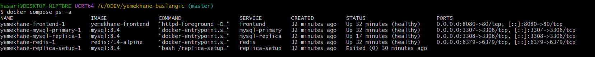
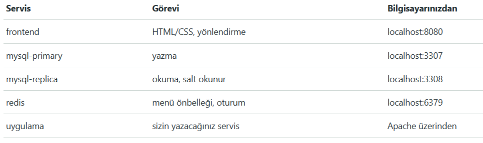

# Yemekhane Otomasyonu · Dönem Ödevi Raporu

**Ders:** Web Teknolojileri
**Öğrenci:** Hasari Güneş · ÖĞRENCİ NO
**Depo:** https://github.com/KULLANICI/yemekhane

**Seçilen mimari: Web API + arayüz.**
Uygulama Node.js 22 + Express ile yazılmıştır ve yalnızca JSON döner. HTML5 + CSS3 arayüz
`frontend/` klasöründe durur, Apache tarafından sunulur ve veriyi JavaScript `fetch` ile alır.
Apache `/api/` isteklerini `uygulama` servisine (port 8000) iletir.

---

## Aşama 1 · Altyapı

Ortam: Windows 11, Docker Desktop 4.99.0 (WSL 2), komutlar Git Bash'te çalıştırıldı.

Başlangıç paketi depo kökünde `docker compose up -d` ile ek adım olmadan ayağa kalktı.
Doğrulama komutlarının tamamı `rapor/asama1-dogrulama.sh` betiğiyle sırayla çalıştırıldı;
betik her komutu ve çıktısını `rapor/asama1-cikti.txt` dosyasına yazar. Aşağıda her madde için
komut ve çıktı verilmiştir (parola uyarısı satırları çıkarılmıştır).

### 1.1 Tüm servisler healthy, replica-setup başarıyla çıkmış

```
$ docker compose ps -a
NAME                        IMAGE                SERVICE         STATUS
yemekhane-frontend-1        yemekhane-frontend   frontend        Up 13 minutes (healthy)
yemekhane-mysql-primary-1   mysql:8.4            mysql-primary   Up 13 minutes (healthy)
yemekhane-mysql-replica-1   mysql:8.4            mysql-replica   Up 4 minutes (healthy)
yemekhane-redis-1           redis:7.4-alpine     redis           Up 13 minutes (healthy)
yemekhane-replica-setup-1   mysql:8.4            replica-setup   Exited (0) 12 minutes ago
```



Dört uzun ömürlü servis `healthy`, tek seferlik `replica-setup` servisi `Exited (0)` ile
başarıyla çıkmıştır. Günlüğü kurulum adımlarını ve ikinci `docker compose up -d` çağrısında
kurulumun tekrarlanmadığını gösterir:

```
$ docker compose logs replica-setup
[replica-setup] Kaynakta replikasyon kullanıcısı oluşturuluyor.
[replica-setup] Kaynağın anlık kopyası alınıyor.
[replica-setup] Kopya replikaya yükleniyor.
[replica-setup] Replikasyon başlatılıyor.
[replica-setup] Replikasyon çalışıyor (IO=Yes, SQL=Yes). Replika salt okunur.
[replica-setup] Replika zaten yapılandırılmış, işlem yapılmadı.
```

Replikasyonun durumu: IO ve SQL iş parçacıkları çalışıyor, gecikme 0 saniye, hata yok.

```
$ docker compose exec -T mysql-replica mysql --default-character-set=utf8mb4 -uroot -pyemekhane_kok \
    -e "SHOW REPLICA STATUS\G" | grep -E 'Source_Host|Replica_IO_Running|Replica_SQL_Running:|Seconds_Behind_Source|Last_IO_Error:|Last_SQL_Error:'
                  Source_Host: mysql-primary
           Replica_IO_Running: Yes
          Replica_SQL_Running: Yes
        Seconds_Behind_Source: 0
                Last_IO_Error:
               Last_SQL_Error:
```

Apache de `http://localhost:8080` adresinde başlangıç sayfasını sunmaktadır (uygulama servisi
henüz eklenmediği için sayfa "Uygulama servisine ulaşılamıyor" uyarısını gösterir):



### 1.2 Kaynakta yapılan bakiye yüklemesi replikada görünüyor

Kaynakta 7 numaralı kullanıcının bakiyesi 655,00 TL'dir. `sp_bakiye_yukle` yordamı **kaynakta**
çağrılarak 100 TL yüklenir:

```
$ docker compose exec -T mysql-primary mysql --default-character-set=utf8mb4 -t -uyemekhane_app -pUyg_2026 yemekhane \
    -e "SELECT id, ad, soyad, bakiye FROM kullanicilar WHERE id = 7"
+----+--------+----------+--------+
| id | ad     | soyad    | bakiye |
+----+--------+----------+--------+
|  7 | Mehmet | Yıldız   | 655.00 |
+----+--------+----------+--------+

$ docker compose exec -T mysql-primary mysql --default-character-set=utf8mb4 -t -uyemekhane_app -pUyg_2026 yemekhane \
    -e "CALL sp_bakiye_yukle(7, 100)"
+------------+--------+
| hareket_id | bakiye |
+------------+--------+
|        457 | 755.00 |
+------------+--------+
```

Aynı sorgu **replikada** çalıştırıldığında yeni bakiye ve yeni bakiye hareketi görünür:

```
$ docker compose exec -T mysql-replica mysql --default-character-set=utf8mb4 -t -uyemekhane_app -pUyg_2026 yemekhane \
    -e "SELECT id, ad, soyad, bakiye FROM kullanicilar WHERE id = 7"
+----+--------+----------+--------+
| id | ad     | soyad    | bakiye |
+----+--------+----------+--------+
|  7 | Mehmet | Yıldız   | 755.00 |
+----+--------+----------+--------+

$ docker compose exec -T mysql-replica mysql --default-character-set=utf8mb4 -t -uyemekhane_app -pUyg_2026 yemekhane \
    -e "SELECT id, tur, tutar, aciklama, olusturma FROM bakiye_hareketleri WHERE kullanici_id = 7 ORDER BY id DESC LIMIT 1"
+-----+---------+--------+-----------------+---------------------+
| id  | tur     | tutar  | aciklama        | olusturma           |
+-----+---------+--------+-----------------+---------------------+
| 457 | yukleme | 100.00 | Bakiye yükleme  | 2026-11-18 19:48:47 |
+-----+---------+--------+-----------------+---------------------+
```

Hem `kullanicilar` tablosundaki güncelleme hem de `bakiye_hareketleri` tablosuna eklenen satır
(aynı `hareket_id` = 457) replikaya geçmiştir; yordamın tek transaction'ı replikada bütün
olarak uygulanmıştır.

### 1.3 Replikaya yazma denemesi read-only hatasıyla reddediliyor

`replica-setup` replikayı `SET PERSIST` ile kalıcı olarak salt okunur yapmıştır:

```
$ docker compose exec -T mysql-replica mysql --default-character-set=utf8mb4 -t -uyemekhane_app -pUyg_2026 yemekhane \
    -e "SELECT @@read_only, @@super_read_only"
+-------------+-------------------+
| @@read_only | @@super_read_only |
+-------------+-------------------+
|           1 |                 1 |
+-------------+-------------------+
```

Uygulama kullanıcısının replikada yazma yetkisi olduğu hâlde hem yordam çağrısı hem de doğrudan
`UPDATE` reddedilir. Hata yetki hatası değil, read-only hatasıdır (ERROR 1290):

```
$ docker compose exec -T mysql-replica mysql --default-character-set=utf8mb4 -t -uyemekhane_app -pUyg_2026 yemekhane \
    -e "CALL sp_bakiye_yukle(7, 50)"
ERROR 1290 (HY000) at line 1: The MySQL server is running with the --super-read-only option so it cannot execute this statement

$ docker compose exec -T mysql-replica mysql --default-character-set=utf8mb4 -t -uyemekhane_app -pUyg_2026 yemekhane \
    -e "UPDATE kullanicilar SET bakiye = 0 WHERE id = 7"
ERROR 1290 (HY000) at line 1: The MySQL server is running with the --read-only option so it cannot execute this statement
```

Bu yüzden uygulamada yazma işlemleri (yordam çağrıları dahil) yalnızca `mysql-primary`
bağlantısından yapılmalıdır.

### 1.4 Replika durdurulup başlatıldığında aradaki değişiklikleri yakalıyor

Replika durdurulur, durduğu doğrulanır:

```
$ docker compose stop mysql-replica
 Container yemekhane-mysql-replica-1 Stopped

$ docker compose ps -a mysql-replica
NAME                        IMAGE       SERVICE         STATUS
yemekhane-mysql-replica-1   mysql:8.4   mysql-replica   Exited (0) Less than a second ago
```

Replika kapalıyken kaynakta 200 TL yüklenir; kaynaktaki bakiye 955,00 TL olur:

```
$ docker compose exec -T mysql-primary mysql --default-character-set=utf8mb4 -t -uyemekhane_app -pUyg_2026 yemekhane \
    -e "CALL sp_bakiye_yukle(7, 200)"
+------------+--------+
| hareket_id | bakiye |
+------------+--------+
|        458 | 955.00 |
+------------+--------+
```

Replika yeniden başlatılır ve `healthy` olduktan sonra aynı bakiye replikada görünür:

```
$ docker compose start mysql-replica
 Container yemekhane-mysql-replica-1 Started

$ docker compose ps -a mysql-replica
NAME                        IMAGE       SERVICE         STATUS
yemekhane-mysql-replica-1   mysql:8.4   mysql-replica   Up 8 seconds (healthy)

$ docker compose exec -T mysql-replica mysql --default-character-set=utf8mb4 -t -uyemekhane_app -pUyg_2026 yemekhane \
    -e "SELECT id, bakiye FROM kullanicilar WHERE id = 7"
+----+--------+
| id | bakiye |
+----+--------+
|  7 | 955.00 |
+----+--------+

$ docker compose exec -T mysql-replica mysql --default-character-set=utf8mb4 -uroot -pyemekhane_kok \
    -e "SHOW REPLICA STATUS\G" | grep -E 'Replica_IO_Running|Replica_SQL_Running:|Seconds_Behind_Source|Retrieved_Gtid_Set|Executed_Gtid_Set'
           Replica_IO_Running: Yes
          Replica_SQL_Running: Yes
        Seconds_Behind_Source: 0
           Retrieved_Gtid_Set: f7bef3df-e36d-11f1-aaee-d611d0c6d975:43-46
            Executed_Gtid_Set: f7bef3df-e36d-11f1-aaee-d611d0c6d975:1-46
```

Replikasyon GTID otomatik konumlandırma (`SOURCE_AUTO_POSITION = 1`) ile kurulduğu için replika
yeniden bağlandığında kaynağa "elimde 1–45 arası işlemler var" bilgisini gönderir, kaynak da
eksik olan 46 numaralı işlemi (kapalıyken yapılan 200 TL yükleme) yollar. `Executed_Gtid_Set`
değerinin `1-46` olması replikanın kaynaktaki tüm işlemleri uyguladığını gösterir.

### 1.5 Ek: bakiye tutarlılığı

Şemadaki "bakiye her zaman hareketlerin toplamına eşittir" kuralı replikada da geçerlidir:

```
$ docker compose exec -T mysql-replica mysql --default-character-set=utf8mb4 -t -uyemekhane_app -pUyg_2026 yemekhane \
    -e "SELECT k.id, k.bakiye, SUM(h.tutar) AS hareket_toplami FROM kullanicilar k JOIN bakiye_hareketleri h ON h.kullanici_id = k.id WHERE k.id = 7 GROUP BY k.id, k.bakiye"
+----+--------+-----------------+
| id | bakiye | hareket_toplami |
+----+--------+-----------------+
|  7 | 955.00 |          955.00 |
+----+--------+-----------------+

$ docker compose exec -T redis redis-cli ping
PONG
```

---

## Aşama 2 · Uygulama

## Aşama 3 · Redis

## Aşama 4 · Değişiklik talebi
